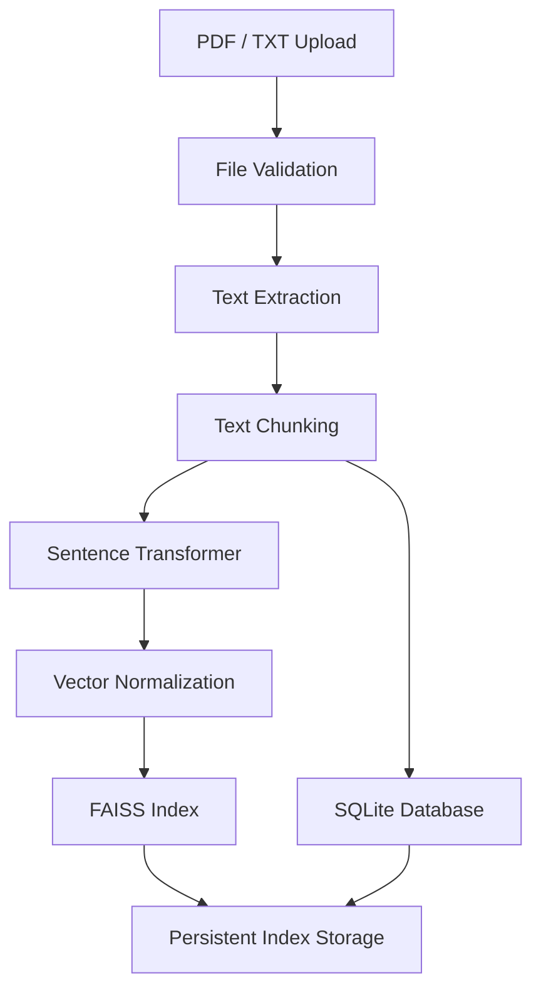
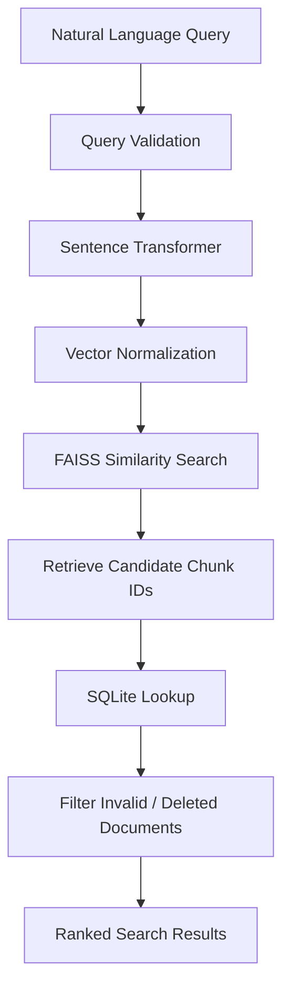

# Vectorix— Local Semantic Search Engine

A locally hosted semantic search engine for PDF and TXT documents, built with Flask, Sentence Transformers, FAISS, and SQLite.

Semantix allows users to upload documents and search through their contents using natural-language queries. Instead of matching exact keywords, it converts document passages and search queries into vector embeddings and retrieves passages based on semantic similarity.

The entire pipeline runs locally on CPU. No paid APIs, GPU, or external inference services are required.

## Overview

Traditional keyword search can miss relevant information when the wording of a query differs from the wording used in a document.

vectorix addresses this by using sentence embeddings to represent text as numerical vectors. Similar meanings produce vectors that are closer in the embedding space, allowing the engine to retrieve relevant passages even when they do not share the same keywords.

**Example:**

A document contains:

> Classification and regression are two types of supervised learning.

A user searches:

> What are the different approaches to supervised machine learning?

The engine can retrieve the relevant passage without requiring an exact keyword match.

## Features

- **Document ingestion:** Upload PDF and TXT files with file validation and duplicate detection.
- **Text extraction:** Extract PDF content page by page using PyMuPDF.
- **Text chunking:** Split extracted content into overlapping chunks while preserving page information.
- **Semantic embeddings:** Generate 384-dimensional embeddings using `all-MiniLM-L6-v2`.
- **Vector retrieval:** Perform exact similarity search using FAISS `IndexFlatIP`.
- **Document management:** Upload, inspect, list, and delete documents.
- **Persistent storage:** Store document metadata in SQLite and vector data on disk.
- **Index recovery:** Rebuild the vector index from stored document chunks.
- **Health monitoring:** Check database and vector index consistency.
- **Local dashboard:** Upload documents and explore search results through a browser interface.

## Architecture

vectorix separates HTTP handling, business logic, database operations, and vector retrieval into independent components.

### Document ingestion pipeline



### Search pipeline



### Main components

| Component | Responsibility |
|---|---|
| Flask API | Handles document and search requests |
| Extraction service | Extracts text from PDF and TXT files |
| Chunking service | Splits text into manageable passages |
| Embedding service | Converts text into dense vectors |
| Vector store | Performs similarity search and manages the FAISS index |
| SQLite | Stores documents, chunks, and metadata |
| Search service | Coordinates retrieval and result construction |
| Frontend | Provides the document management and search interface |

## Technology Stack

| Technology | Purpose |
|---|---|
| Python | Core application logic |
| Flask | REST API and application server |
| Sentence Transformers | Text embeddings |
| all-MiniLM-L6-v2 | Pretrained embedding model |
| FAISS | Vector similarity search |
| NumPy | Vector operations and fallback retrieval |
| SQLite | Document and chunk metadata |
| PyMuPDF | PDF text extraction |
| Bootstrap 5 | Dashboard styling |
| Vanilla JavaScript | Frontend interactions |
| pytest | Automated testing |

### Why these technologies?

**Sentence Transformers**

The `all-MiniLM-L6-v2` model generates 384-dimensional sentence embeddings. It provides a practical balance between semantic retrieval quality, model size, and CPU inference speed.

**FAISS**

FAISS provides efficient vector similarity search. Semantix uses `IndexFlatIP`, which performs exact inner-product search rather than approximate nearest-neighbour retrieval.

**SQLite**

SQLite provides persistent metadata storage without requiring a separate database server. It stores document information, extracted chunks, and vector-position mappings.

**NumPy**

NumPy handles vector normalization, storage snapshots, and an alternative exact-search implementation when FAISS is unavailable.

## How Semantic Retrieval Works

### 1. Text extraction

Uploaded files are processed using PyMuPDF for PDFs and text decoding for TXT files.

PDF pages are processed independently so that the original page information can be retained.

### 2. Chunking

Large documents are divided into smaller overlapping passages.

The default configuration is:

- Chunk size: 700 characters
- Chunk overlap: 120 characters

Overlap helps preserve context when relevant information falls near a chunk boundary.

### 3. Embedding generation

Each chunk is passed through the Sentence Transformer model.

The resulting vectors represent the semantic content of the passages.

The same model is used to encode incoming search queries, ensuring that both documents and queries occupy the same embedding space.

### 4. Vector normalization

All embedding vectors are L2-normalized before being added to the index.

This allows cosine similarity to be calculated using the inner product:

\[
\operatorname{cosine}(A,B)=A\cdot B
\]

This works because both vectors have a unit L2 norm.

### 5. Similarity search

FAISS `IndexFlatIP` compares the query vector against stored document vectors and returns the highest-scoring matches.

The retrieved vector positions are mapped back to chunk IDs using a manifest, and SQLite is used to fetch the corresponding document content and metadata.

Search results include:

- Document name
- Extracted passage
- PDF page number, where applicable
- Similarity score
- Chunk information

## Persistence and Index Management

vectorix maintains separate storage for document metadata and vector representations.

| Storage | Contents |
|---|---|
| SQLite | Documents, chunks, metadata, vector positions |
| FAISS | Persistent vector index |
| NumPy | Normalized vector snapshot |
| JSON manifest | Vector-position-to-chunk mapping |
| Upload directory | Original uploaded files |

The application also includes safeguards for maintaining consistency between SQLite and the vector index.

For example, when a document is deleted, its associated vectors are removed and the remaining vector positions are updated.

Search results are also validated against SQLite so that stale vector entries cannot return deleted documents.

An index rebuild operation is available to regenerate the vector index from stored chunks.

## Project Structure

```text
Semantix/
│
├── app.py
├── config.py
├── requirements.txt
├── requirements-dev.txt
├── .env.example
├── .gitignore
├── README.md
│
├── backend/
│   ├── app_factory.py
│   ├── container.py
│   │
│   ├── routes/
│   │   ├── documents.py
│   │   ├── search.py
│   │   └── system.py
│   │
│   ├── services/
│   │   ├── extraction.py
│   │   ├── chunking.py
│   │   ├── embeddings.py
│   │   ├── vector_store.py
│   │   ├── ingestion.py
│   │   ├── search.py
│   │   ├── documents.py
│   │   └── health.py
│   │
│   ├── database/
│   │   ├── connection.py
│   │   └── repositories.py
│   │
│   ├── models/
│   │   └── entities.py
│   │
│   └── utils/
│       ├── errors.py
│       ├── files.py
│       ├── logging.py
│       └── responses.py
│
├── frontend/
│   ├── templates/
│   │   └── index.html
│   └── static/
│       ├── css/
│       ├── js/
│       ├── img/
│       └── vendor/
│
├── sample_data/
├── scripts/
│   └── check_environment.py
│
├── storage/             # Runtime data (gitignored)
│
└── tests/
    ├── conftest.py
    ├── support.py
    ├── test_extraction.py
    ├── test_chunking.py
    ├── test_embeddings.py
    ├── test_vector_store.py
    ├── test_search.py
    ├── test_api_documents.py
    ├── test_document_deletion.py
    └── test_index_rebuild.py
```

## Getting Started

### Prerequisites

- Python 3.10–3.13 recommended
- Windows, Linux, or macOS
- Approximately 1 GB of free disk space for dependencies and model cache
- Internet connection for the initial model download
- No GPU required

### 1. Clone the repository

```bash
git clone https://github.com/USERNAME/Semantix.git
cd Semantix
```

### 2. Create a virtual environment

**Windows:**

```bash
python -m venv .venv
.venv\Scripts\activate
```

**Linux / macOS:**

```bash
python3 -m venv .venv
source .venv/bin/activate
```

### 3. Install dependencies

```bash
python -m pip install --upgrade pip
pip install -r requirements.txt
```

### 4. Configure environment variables

**Windows:**

```powershell
Copy-Item .env.example .env
```

**Linux / macOS:**

```bash
cp .env.example .env
```

The default configuration is sufficient for local execution.

### 5. Verify the environment

```bash
python scripts/check_environment.py
```

### 6. Run the application

```bash
python app.py
```

Open the dashboard:

```text
http://127.0.0.1:5000
```

The embedding model is loaded lazily when the first ingestion or search operation is performed.

## API Reference

Base URL:

```text
http://127.0.0.1:5000/api
```

| Method | Endpoint | Description |
|---|---|---|
| POST | `/documents/upload` | Upload and process a document |
| GET | `/documents` | List uploaded documents |
| GET | `/documents/{id}` | Retrieve document details |
| DELETE | `/documents/{id}` | Delete a document |
| POST | `/search` | Perform semantic search |
| GET | `/health` | Check application and index health |
| POST | `/index/rebuild` | Rebuild the vector index |

### Example: Search request

```bash
curl -X POST http://127.0.0.1:5000/api/search \
  -H "Content-Type: application/json" \
  -d '{
    "query": "What are the different types of supervised learning?",
    "top_k": 5
  }'
```

The response contains ranked passages, their source documents, page information, and similarity scores.

## Testing

The project includes automated tests covering the major application components.

Run the test suite:

```bash
pip install -r requirements-dev.txt
python -m pytest -q
```

**Verified test result in the development environment:**

```text
83 passed
```

The test suite uses:

- Temporary directories for isolated storage.
- A deterministic test embedder instead of downloading the actual embedding model.
- NumPy for portable vector-search tests.
- Generated PDF files for extraction tests.
- Flask test clients for API testing.

Tests cover document ingestion, text extraction, chunking, embeddings, vector persistence, search, document deletion, index rebuilding, and error handling.

## Current Limitations

- OCR is not implemented, so image-only PDFs cannot be indexed.
- Retrieval quality depends on the selected embedding model.
- `IndexFlatIP` performs exact search, which can become computationally expensive as the vector collection grows.
- The current application is designed for single-user local deployment.
- Search currently relies on dense vector retrieval rather than hybrid keyword and semantic retrieval.

## Future Improvements

Potential areas for extending the project:

- OCR support for scanned documents.
- Hybrid search combining keyword and vector retrieval.
- Cross-encoder reranking of retrieved passages.
- Support for additional document formats.
- Approximate nearest-neighbour indexing for larger collections.
- More detailed retrieval evaluation using benchmark datasets.

## Design Considerations

vectorix prioritizes local execution, reproducibility, and understandable retrieval behaviour.

Using a relatively lightweight embedding model and an exact vector index makes it possible to inspect and reason about the retrieval process without relying on external inference services.

The current architecture is intended for small-to-medium local document collections rather than large-scale distributed search infrastructure.

---

**Built with Python, Flask, Sentence Transformers, FAISS, and SQLite.**

