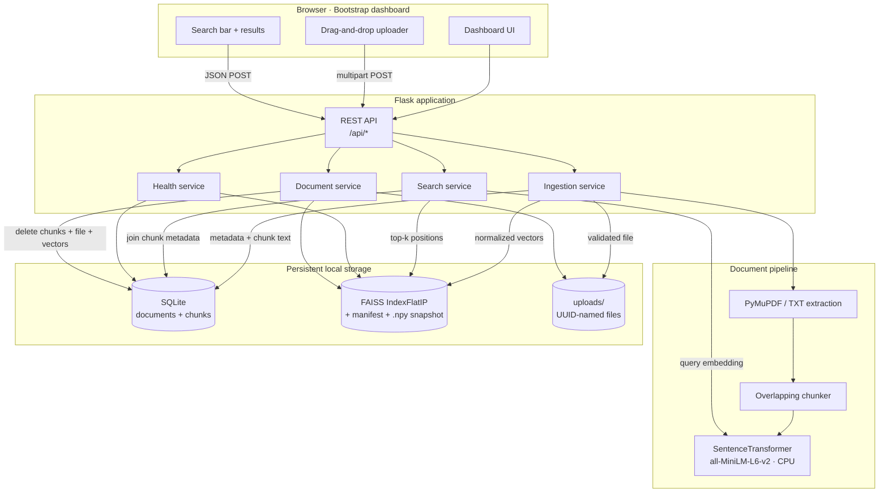

# SemanticSearch

A complete, locally hosted semantic search engine for PDF and TXT documents.

Upload a library, ask natural-language questions, and retrieve the passages that
match **meaning** — not just exact keywords. Everything runs on your machine:
Flask REST API, SQLite metadata, PyMuPDF extraction, `sentence-transformers`
embeddings on CPU, and a persistent FAISS vector index. No paid APIs, no GPU,
and no document leaves the machine.

> **Example:** a document that says *"classification and regression are
> supervised tasks"* can be found by the query *"What are the different types of
> supervised learning?"* even if that exact phrase never appears.

---

## Table of contents

1. [Features](#features)
2. [Architecture](#architecture)
3. [Project structure](#project-structure)
4. [Technology choices](#technology-choices)
5. [Installation](#installation)
6. [Running the application](#running-the-application)
7. [Configuration](#configuration)
8. [API reference](#api-reference)
9. [How the embedding pipeline works](#how-the-embedding-pipeline-works)
10. [How FAISS similarity search works](#how-faiss-similarity-search-works)
11. [Persistence and consistency](#persistence-and-consistency)
12. [Security and error handling](#security-and-error-handling)
13. [Testing](#testing)
14. [Limitations](#limitations)
15. [Future improvements](#future-improvements)
16. [Troubleshooting](#troubleshooting)
17. [Interview concepts](#interview-concepts)

---

## Features

- **PDF + TXT ingestion** with extension, signature, size, duplicate, and empty
  file validation.
- **Page-aware extraction** with PyMuPDF. PDF results retain their real page
  number; TXT results are marked as page-less.
- **Overlapping, word-aware chunking** with configurable size and overlap.
- **CPU embeddings** using `sentence-transformers/all-MiniLM-L6-v2` (384
  dimensions), L2-normalized for cosine similarity.
- **Persistent FAISS `IndexFlatIP`** with a manifest that maps vector positions
  to chunk IDs. The native index, an atomic NumPy vector snapshot, and the
  manifest are written to disk.
- **Natural-language top-k search** with raw cosine scores, document names,
  page numbers, and chunk citations.
- **Document management**: upload, list, inspect, delete, duplicate prevention
  via SHA-256, and a full index rebuild endpoint.
- **Consistency safeguards**: deletion removes vectors; SQLite joins guarantee
  deleted documents can never reappear from stale vectors; health reports index
  drift.
- **Polished responsive dashboard**: drag-and-drop upload queue, search
  skeletons, similarity dials, empty states, toasts, delete/rebuild modals,
  status polling, and keyboard/touch support.
- **No CDNs at runtime**: Bootstrap and all assets are vendored locally.
- **83 pytest tests**, fully isolated and runnable without downloading a model.
- **Graceful fallbacks** for constrained machines:
  - NumPy exact inner-product index when FAISS cannot load.
  - Deterministic hashing embedder for offline demos/tests (explicitly not a
    semantic model).

---

## Architecture



### Request flows

**Ingestion**

```text
Upload → validate filename/extension/size → stream to UUID temp file while
SHA-256 hashing → duplicate check → extract text → split into overlapping
chunks per page → embed all chunks in batches → normalize vectors → insert
document + chunks into SQLite (transaction) → add vectors to FAISS → persist
index + manifest → sync vector positions → return created document
```

If any step fails, the pipeline removes the temp file, any stored file, vector
entries, and database rows so a failed upload can be retried cleanly.

**Search**

```text
Question → validate → embed + normalize query → FAISS top-k inner product
(over-fetch) → fetch candidate chunks from SQLite → discard hits whose document
was deleted → return top-k with cosine scores and page metadata
```

---

## Project structure

```text
semantic search engine/
├── app.py                        # Entry point (factory + local server)
├── config.py                     # Typed env configuration
├── requirements.txt
├── requirements-dev.txt
├── .env.example
├── .gitignore
├── pytest.ini
├── README.md
│
├── sample_data/
│   ├── machine_learning.txt
│   ├── vector_search_notes.txt
│   └── semantic_search_primer.pdf
│
├── scripts/
│   └── check_environment.py      # Dependency/model verification
│
├── backend/
│   ├── app_factory.py            # Flask app factory, logging, error handlers
│   ├── container.py              # Composition root / dependency wiring
│   ├── routes/
│   │   ├── documents.py          # Upload, list, get, delete
│   │   ├── search.py             # Semantic search endpoint
│   │   └── system.py             # Dashboard, health, index rebuild
│   ├── services/
│   │   ├── extraction.py         # PyMuPDF + TXT decoding
│   │   ├── chunking.py           # Overlapping word-aware chunker
│   │   ├── embeddings.py         # SentenceTransformer / hashing backends
│   │   ├── vector_store.py       # FAISS IndexFlatIP + NumPy fallback + persistence
│   │   ├── ingestion.py          # Upload → extract → chunk → embed → index
│   │   ├── search.py             # Query validation, retrieval, result fusion
│   │   ├── documents.py          # Listing, deletion, rebuild
│   │   └── health.py             # Database/index sync diagnostics
│   ├── database/
│   │   ├── connection.py         # SQLite schema, WAL, connections
│   │   └── repositories.py       # All SQL and row mapping
│   ├── models/
│   │   └── entities.py           # Dataclasses shared by services/routes
│   └── utils/
│       ├── errors.py             # Domain errors → HTTP status codes
│       ├── files.py              # Filename sanitization, path guards
│       ├── logging.py            # Rotating file + console logging
│       └── responses.py          # Consistent JSON envelopes
│
├── frontend/
│   ├── templates/
│   │   └── index.html            # Dashboard
│   └── static/
│       ├── css/styles.css
│       ├── js/app.js             # Vanilla JS UI logic
│       ├── img/favicon.svg
│       └── vendor/               # Bootstrap CSS/JS (local copies)
│
├── storage/                      # Git-ignored runtime data
│   ├── uploads/                  # UUID-named source files
│   ├── indexes/                  # manifest.json, vectors.npy, semantic.faiss
│   ├── logs/
│   └── semantic_search.db
│
└── tests/
    ├── conftest.py               # Isolated app + deterministic embedder
    ├── support.py                # Test embedder, PDF/TXT upload helpers
    ├── test_extraction.py
    ├── test_chunking.py
    ├── test_embeddings.py
    ├── test_vector_store.py
    ├── test_search.py
    ├── test_api_documents.py
    ├── test_document_deletion.py
    └── test_index_rebuild.py
```

The code intentionally separates **routes** (HTTP concerns), **services**
(business logic), **repositories** (SQL), **models** (domain objects), and
**utilities**. `app.py` only builds and runs the app; it contains no business
logic.

---

## Technology choices

| Layer | Choice | Reasoning |
|---|---|---|
| API | **Flask 3** | Small, explicit, excellent for local REST services and test clients. App factory + blueprints keep it modular. |
| Metadata | **SQLite (WAL)** | Zero-ops embedded relational store; transactional inserts and `ON DELETE CASCADE`; perfect for a single-user local app. |
| PDF extraction | **PyMuPDF** | Fast, reliable text extraction with per-page access and page counts; no external runtime. |
| Embeddings | **sentence-transformers + all-MiniLM-L6-v2** | Strong semantic quality at 384 dimensions, ~90 MB, fast on CPU, no paid API. |
| Vector search | **FAISS IndexFlatIP** | Exact inner-product search; with L2-normalized vectors this is cosine similarity. Simple, deterministic, and ideal for a local corpus. |
| Numeric layer | **NumPy** | Batch normalization, vector snapshots, fallback search, score math. |
| Frontend | **Bootstrap 5 + HTML/CSS + vanilla JS** | No build step, no runtime CDN, easy to run and audit. |
| Tests | **pytest** | Fixtures + dependency injection make it trivial to swap a deterministic embedder and temporary storage. |

---

## Installation

### Prerequisites

- Python **3.10–3.13 recommended** (3.14 may work if current PyTorch/FAISS
  wheels are available for your platform).
- A C++/native wheel-compatible OS: Windows x64, Linux x64, or macOS.
- ~1 GB free disk for Python dependencies and the model cache.
- No GPU. All inference runs on CPU.
- Internet access on the **first** model download (later runs are offline).

> The app uses only free, local libraries. There is no OpenAI key or paid API
> anywhere in the codebase.

### 1. Create and activate a virtual environment

**Windows (PowerShell)**

```powershell
cd "semantic search engine"
python -m venv .venv
.\.venv\Scripts\Activate.ps1
python -m pip install --upgrade pip
python -m pip install -r requirements.txt
```

If PowerShell blocks activation scripts:

```powershell
Set-ExecutionPolicy -Scope Process -ExecutionPolicy Bypass
```

**macOS / Linux**

```bash
cd "semantic search engine"
python3 -m venv .venv
source .venv/bin/activate
python -m pip install --upgrade pip
python -m pip install -r requirements.txt
```

### 2. Create your local configuration

**Windows**

```powershell
Copy-Item .env.example .env
```

**macOS / Linux**

```bash
cp .env.example .env
```

The defaults in `.env.example` work out of the box. Set a different
`SECRET_KEY` if you expose the app beyond your machine.

### 3. Pre-download the embedding model (optional but recommended)

The model downloads lazily on the first upload/search. You can pre-download it:

```bash
python -c "from sentence_transformers import SentenceTransformer; SentenceTransformer('sentence-transformers/all-MiniLM-L6-v2')"
```

It is cached under `storage/models` (configurable via `EMBEDDING_CACHE_DIR`).
After that, the app can run fully offline.

### 4. Verify dependencies

```bash
python scripts/check_environment.py
```

This reports Python, Flask, NumPy, PyMuPDF, FAISS, and sentence-transformers
availability without requiring a document upload.

---

## Running the application

```bash
python app.py
```

Then open **http://127.0.0.1:5000**.

You can also use the Flask CLI:

```bash
flask --app app:app run --debug
```

For a different host/port:

```powershell
$env:APP_PORT="5001"; python app.py
```

```bash
APP_PORT=5001 python app.py
```

### Quick demo with the sample data

1. Open the dashboard.
2. Drag `sample_data/machine_learning.txt`,
   `sample_data/vector_search_notes.txt`, and
   `sample_data/semantic_search_primer.pdf` into the upload area.
3. Wait for the **Indexed** badge on each file.
4. Search:
   - *"What are the different types of supervised learning?"*
   - *"How does semantic similarity search work?"*
   - *"What causes a model to overfit?"*

Results show the source filename, PDF page number, a cosine similarity
percentage, the raw score, and the exact passage.

### Production note

This is a local, single-user application. Do not run multiple worker processes
against the same storage directory: the in-process lock coordinates index
mutations, and SQLite/FAISS files are not designed for multi-writer access.
For a local deployment, a single process with the Flask server is appropriate.
Put authentication and TLS in front of it if you expose it to a network.

---

## Configuration

All settings are read from environment variables (and `.env`). Paths are
resolved relative to the project root, so no machine-specific path is
hardcoded. See `.env.example` for the full list.

| Variable | Default | Description |
|---|---|---|
| `SECRET_KEY` | `dev-only-change-me` | Flask session/signing key. Change outside local dev. |
| `APP_HOST` | `127.0.0.1` | Bind address used by `python app.py`. |
| `APP_PORT` | `5000` | Bind port. |
| `FLASK_DEBUG` | `0` | `1` enables the debugger/reloader. Never use in production. |
| `LOG_LEVEL` | `INFO` | `DEBUG`, `INFO`, `WARNING`, etc. |
| `LOG_TO_FILE` | `1` | Write rotating logs to `storage/logs/semanticsearch.log`. |
| `STORAGE_DIR` | `storage` | Root for runtime data. |
| `UPLOAD_DIR` | `storage/uploads` | Source file storage. |
| `INDEX_DIR` | `storage/indexes` | Vector snapshot, manifest, FAISS file. |
| `DATABASE_PATH` | `storage/semantic_search.db` | SQLite database. |
| `LOG_DIR` | `storage/logs` | Log directory. |
| `MAX_UPLOAD_MB` | `25` | Per-file byte limit (also enforced while streaming). |
| `ALLOWED_EXTENSIONS` | `pdf,txt` | Comma-separated allow-list. |
| `CHUNK_SIZE` | `700` | Target chunk size in characters. |
| `CHUNK_OVERLAP` | `120` | Overlap in characters; must be < chunk size. |
| `EMBEDDING_BACKEND` | `sentence-transformers` | `sentence-transformers` or `hashing` (offline demo only). |
| `EMBEDDING_MODEL` | `sentence-transformers/all-MiniLM-L6-v2` | Any compatible ST model. Changing it requires an index rebuild. |
| `EMBEDDING_DEVICE` | `cpu` | Keep `cpu` for this project. |
| `EMBEDDING_BATCH_SIZE` | `32` | Model encoding batch size. |
| `EMBEDDING_CACHE_DIR` | `storage/models` | Hugging Face / ST cache directory. |
| `EMBEDDING_DIMENSION` | `384` | Used by the hashing fallback; real models report their own dimension. |
| `VECTOR_BACKEND` | `auto` | `auto`, `faiss`, or `numpy`. |
| `TOP_K_DEFAULT` | `5` | Default result count. |
| `TOP_K_MAX` | `20` | Maximum accepted `top_k`. |
| `MAX_QUERY_LENGTH` | `1000` | Maximum query characters. |

---

## API reference

Base URL: `http://127.0.0.1:5000/api`

Successful JSON responses use a `data` envelope. Errors use an `error` object:

```json
{
  "error": {
    "code": "validation_error",
    "message": "Please enter a search query."
  }
}
```

### `POST /api/documents/upload`

Multipart upload with a `file` field. Accepts `.pdf` and `.txt`.

```bash
curl -F "file=@sample_data/machine_learning.txt" \
     http://127.0.0.1:5000/api/documents/upload
```

**201 Created**

```json
{
  "data": {
    "id": "70d7eac669814267b08f8da0851ea76e",
    "name": "machine_learning.txt",
    "file_size": 4731,
    "mime_type": "text/plain",
    "page_count": 0,
    "chunk_count": 8,
    "status": "ready",
    "created_at": "2026-11-13T13:12:12+00:00",
    "error_message": null
  }
}
```

Common failures:

| Status | Code | Cause |
|---|---|---|
| 400 | `validation_error` | Missing file, unsupported extension, empty file, invalid filename. |
| 409 | `conflict` | Identical SHA-256 already uploaded. Includes `details.document_id`. |
| 413 | `file_too_large` | Exceeds `MAX_UPLOAD_MB`. |
| 422 | `extraction_failed` / `empty_document` | Corrupt PDF, binary TXT, encrypted PDF, or no extractable text. |
| 503 | `embedding_unavailable` | Model could not load/download. |

### `GET /api/documents`

```bash
curl http://127.0.0.1:5000/api/documents
```

**200 OK**

```json
{
  "data": [
    {
      "id": "70d7eac669814267b08f8da0851ea76e",
      "name": "machine_learning.txt",
      "file_size": 4731,
      "mime_type": "text/plain",
      "page_count": 0,
      "chunk_count": 8,
      "status": "ready",
      "created_at": "2026-11-13T13:12:12+00:00",
      "error_message": null
    }
  ],
  "meta": { "count": 1 }
}
```

### `GET /api/documents/{document_id}`

Returns one document or `404 not_found`. IDs are UUID hex strings.

### `DELETE /api/documents/{document_id}`

```bash
curl -X DELETE \
  http://127.0.0.1:5000/api/documents/70d7eac669814267b08f8da0851ea76e
```

**200 OK**

```json
{
  "data": {
    "deleted": true,
    "document": { "...": "..." },
    "chunks_removed": 8,
    "vectors_removed": 8,
    "warnings": []
  }
}
```

Deletion removes the SQLite rows (chunks cascade), the stored source file, and
the vectors. Even if vector cleanup ever failed during a crash, search joins
through SQLite and cannot return the deleted document.

### `POST /api/search`

```bash
curl -X POST http://127.0.0.1:5000/api/search \
  -H "Content-Type: application/json" \
  -d '{"query": "What are the different types of supervised learning?", "top_k": 5}'
```

| Field | Type | Rules |
|---|---|---|
| `query` | string | Required, 1–`MAX_QUERY_LENGTH` characters after trimming. |
| `top_k` | integer | Optional, 1–`TOP_K_MAX`; defaults to `TOP_K_DEFAULT`. |

**200 OK** (an empty library is not an HTTP error):

```json
{
  "data": {
    "query": "What are the different types of supervised learning?",
    "top_k": 5,
    "count": 2,
    "results": [
      {
        "chunk_id": "cf6ed4827c684cc19cf1fc512b4a5469",
        "document_id": "70d7eac669814267b08f8da0851ea76e",
        "document_name": "machine_learning.txt",
        "page_number": null,
        "chunk_index": 1,
        "text": "Supervised learning uses a labeled dataset...",
        "score": 0.6731
      }
    ],
    "duration_ms": 18,
    "reason": null,
    "message": null,
    "index": {
      "backend": "faiss",
      "vectors": 24,
      "dimension": 384,
      "embedding_model": "sentence-transformers/all-MiniLM-L6-v2"
    }
  }
}
```

Empty states use a `reason` of `no_documents`, `index_empty`, or `no_matches`,
plus a user-facing `message`. A search against an index built with a different
model returns **409 `index_incompatible`** until the index is rebuilt.

### `POST /api/index/rebuild`

Re-extracts nothing; it **re-embeds every stored chunk** with the current model,
atomically replaces the vector index, and resynchronizes vector positions.

```bash
curl -X POST http://127.0.0.1:5000/api/index/rebuild
```

**200 OK**

```json
{
  "data": {
    "documents": 3,
    "chunks": 24,
    "dimension": 384,
    "embedding_model": "sentence-transformers/all-MiniLM-L6-v2",
    "backend": "faiss",
    "duration_ms": 4120
  }
}
```

Use it after changing `EMBEDDING_MODEL`, after a crash, or when the dashboard
reports that the index is out of sync.

### `GET /api/health`

```bash
curl http://127.0.0.1:5000/api/health
```

```json
{
  "data": {
    "status": "ok",
    "version": "1.0.0",
    "timestamp": "2026-11-13T13:12:12+00:00",
    "database": { "connected": true, "documents": 3, "chunks": 24 },
    "index": {
      "backend": "faiss",
      "faiss_available": true,
      "vectors": 24,
      "dimension": 384,
      "embedding_model": "sentence-transformers/all-MiniLM-L6-v2",
      "in_sync": true,
      "files": { "manifest": true, "vectors": true, "faiss": true }
    },
    "embedding": {
      "backend": "sentence-transformers",
      "model": "sentence-transformers/all-MiniLM-L6-v2",
      "device": "cpu",
      "dimension": null,
      "loaded": false
    },
    "warnings": []
  }
}
```

Returns **503** if the database cannot be opened. The embedding model is not
loaded by this endpoint.

| Endpoint | Method | Success | Purpose |
|---|---|---|---|
| `/api/documents/upload` | POST | 201 | Validate, process, embed, and index one file. |
| `/api/documents` | GET | 200 | List documents. |
| `/api/documents/{id}` | GET | 200 | Fetch a document. |
| `/api/documents/{id}` | DELETE | 200 | Delete a document and its vectors/file. |
| `/api/search` | POST | 200 | Semantic top-k retrieval. |
| `/api/health` | GET | 200/503 | Database/index/model diagnostics. |
| `/api/index/rebuild` | POST | 200 | Re-embed all chunks and replace the index. |
| `/` | GET | 200 | Dashboard. |

All errors use appropriate HTTP status codes and never include stack traces.
SQLite queries are parameterized, and uploaded files are never served.

---

## How the embedding pipeline works

### 1. Extraction

- **TXT** is decoded with BOM-aware UTF-8/UTF-16 detection and a Windows-1252
  fallback. NUL bytes and PDFs masquerading as `.txt` are rejected.
- **PDF** is opened with PyMuPDF from memory, encrypted/corrupt files are
  rejected, and each page's text is normalized. Blank pages are kept in the
  page count but skipped as sources. Image-only PDFs produce an explicit
  "OCR is not enabled" error.

### 2. Chunking

`backend/services/chunking.py` splits each page independently so page metadata
never becomes ambiguous. The splitter works on words and targets a character
budget (default 700 characters) with overlap (default 120). It never slices a
word in half. If a single word exceeds the budget it is kept intact. The next
chunk starts with trailing words from the previous chunk, preserving context
across boundaries.

### 3. Embedding

```python
model = SentenceTransformer(
    "sentence-transformers/all-MiniLM-L6-v2",
    device="cpu",
    cache_folder="storage/models",
)
vectors = model.encode(
    chunks,
    batch_size=32,
    convert_to_numpy=True,
    normalize_embeddings=False,
    show_progress_bar=False,
)
vectors = normalize_rows(vectors)  # L2 norm = 1.0 per row
```

The model is loaded **lazily** on the first ingestion or search. Loading at
startup would unnecessarily block the dashboard and require native PyTorch just
to list documents. `all-MiniLM-L6-v2` returns 384-dimensional vectors; the
service records the dimension and refuses to mix vectors from different models.

Normalization is done in our code even though the model can normalize
internally. This guarantees one consistent invariant for both ingestion and
query paths:

```text
vector / ||vector||₂
```

Zero vectors stay zero and produce a similarity of 0 rather than a division
error.

### 4. Storage

Each chunk gets a UUID. SQLite stores its text, page number, ordering, and a
`vector_position`. The vector itself is appended to the FAISS index. A manifest
keeps the position → chunk-ID mapping. Chunk IDs are also persisted in SQLite
so the search results can be reconstructed with a single join.

---

## How FAISS similarity search works

### Cosine similarity as an inner product

For vectors **a** and **b**:

```text
cosine(a, b) = (a · b) / (||a||₂ · ||b||₂)
```

Because every vector is normalized to length 1, the denominator is 1, so:

```text
cosine(a, b) = a · b
```

FAISS `IndexFlatIP` computes exact inner products. Therefore, a normalized
`IndexFlatIP` search gives exact cosine similarity without a separate metric.

### Retrieval flow

1. The query is encoded by the **same** model used at ingestion.
2. The query vector is L2-normalized.
3. `index.search(query, k)` returns `k` vector positions and scores.
4. Positions are resolved to chunk IDs through the manifest.
5. Chunk IDs are fetched from SQLite with a `JOIN documents` filter.
6. Missing/deleted chunks are discarded (defence against stale index entries).
7. Results are ordered by descending cosine score and limited to `top_k`.

The service over-fetches (`top_k * 3`, capped by index size) so that filtered
stale vectors or deleted documents do not reduce the final result count below
the requested top-k unless the index truly has fewer valid chunks.

### Index persistence

`storage/indexes/` contains:

- `semantic.faiss` — native FAISS index (when FAISS is available).
- `vectors.npy` — normalized float32 matrix, written atomically.
- `manifest.json` — embedding model name, dimension, count, chunk IDs, update
  timestamp, format version.

On startup:

1. Read the manifest and vector snapshot.
2. Verify shape, count, unique IDs, and model metadata.
3. Try to read the FAISS file; verify `d` and `ntotal`.
4. If it is stale or unreadable, reconstruct the index from the NumPy snapshot.
5. If the manifest/index is corrupt, start empty with a warning; the health
   endpoint then reports the drift and the user can rebuild.

Deletion compacts the index by filtering vectors, rebuilding the flat index,
saving atomically, and updating all remaining SQLite `vector_position` values.
A full rebuild re-embeds every chunk from SQLite, which also handles a changed
embedding model.

### NumPy fallback

If `faiss` cannot be imported, `VECTOR_BACKEND=auto` falls back to an exact
NumPy implementation of the same operation:

```python
scores = normalized_vectors @ normalized_query
```

The algorithm, scores, persistence format, manifest, and API behavior are
identical. The fallback is slower at large scale but produces the same ranking
for the same vectors. `VECTOR_BACKEND=faiss` can be used to fail loudly instead
of falling back. The health endpoint exposes the active backend.

---

## Persistence and consistency

| Artifact | Purpose |
|---|---|
| `storage/semantic_search.db` | Documents, chunk text, page numbers, vector positions, hashes, timestamps. WAL mode. |
| `storage/uploads/<uuid>.<ext>` | Original source bytes. UUID names prevent collisions and traversal. Never publicly served. |
| `storage/indexes/vectors.npy` | Normalized vector snapshot. |
| `storage/indexes/manifest.json` | Position→chunk mapping, model, dimension, count. |
| `storage/indexes/semantic.faiss` | Native index file (FAISS mode). |
| `storage/logs/semanticsearch.log` | Rotating application log. |
| `storage/models/` | Cached embedding model. |

Consistency strategy:

- All document + chunk inserts happen in one SQLite transaction.
- Index mutation and persistence happen while holding a shared `RLock`.
- On an ingestion failure, vectors, database rows, and files are rolled back.
- Deletion removes vectors before deleting DB metadata, then compacts positions.
- Search always joins through the documents table, so stale vectors cannot
  expose deleted content.
- `/api/health` compares `vector_count` with `count_ready_chunks` and checks
  model compatibility; the dashboard surfaces drift with a rebuild action.

There are unavoidable multi-step crash windows between SQLite and files. The
system is designed to detect them (health) and repair them (rebuild) rather than
pretend a distributed transaction exists.

---

## Security and error handling

**Upload safety**

- Extension allow-list and maximum file size enforced both by Flask
  (`MAX_CONTENT_LENGTH`) and by the streaming ingestion service.
- Files are stored under generated UUID names, never user-supplied paths.
- `sanitize_original_filename` strips path components and control characters
  for display only.
- `ensure_within_directory` re-validates every resolved path.
- PDF header validation plus PyMuPDF parsing; TXT binary/NUL detection.
- SHA-256 duplicate detection.
- Source files are not mounted or served by Flask static routes. There is no
  download endpoint.
- SQLite access is exclusively parameterized SQL.
- The UI renders untrusted filenames and passages with `textContent`, not
  `innerHTML`; a strict Content-Security-Policy, `X-Content-Type-Options`,
  `X-Frame-Options`, and `Referrer-Policy` are set on responses.
- Shared errors return sanitized JSON; stack traces go to server logs only.

**Graceful states**

| Situation | Behavior |
|---|---|
| Corrupt PDF | 422 with a clear message; no files, rows, or vectors left behind. |
| Empty or image-only PDF/TXT | 422 `empty_document`. |
| Unsupported extension | 400. |
| Oversized upload | 413. |
| Duplicate content | 409 with the existing document ID. |
| Missing/blank/invalid query | 400. |
| Empty library / empty index | 200 with `reason` and a user-facing message. |
| Deleted document | 404 on subsequent operations; vectors compacted. |
| Model cannot load | 503; dashboard shows the actionable error. |
| Model/index mismatch | 409 `index_incompatible`; rebuild from the UI/API. |
| Index/database drift | Health `in_sync: false` plus warning banner. |

---

## Testing

Install dev dependencies and run:

```bash
python -m pip install -r requirements-dev.txt
python -m pytest -q
```

Verified result in this workspace:

```text
83 passed in 7.13s
```

`pytest` tests use:

- a temporary storage directory per test,
- a deterministic, hand-built **topic embedder** (no model download, no network),
- the NumPy vector backend for speed and portability,
- real PDFs generated on the fly with PyMuPDF for extraction tests.

Coverage by concern:

- **Extraction**: UTF-8/BOM/UTF-16/CP1252 TXT, blank pages, page numbers,
  corrupt PDFs, fake PDF headers, binary TXT, unsupported types.
- **Chunking**: character budget, overlap correctness, zero overlap, long
  single words, page separation, deterministic chunk indices.
- **Embeddings**: normalization (including zero vectors), determinism, batch
  calls, query validation, injected sentence-transformer mock, backend factory.
- **Vector index**: add/search ordering, top-k caps, persistence/reload, removal
  and position compaction, replacement, duplicate IDs, dimension mismatch,
  model mismatch, corrupt manifest recovery.
- **Search**: validation, empty-library/index behavior, page citations,
  top-k handling, semantic retrieval without literal query words.
- **API**: health, dashboard render, upload TXT/PDF, list/get, duplicates,
  extensions, missing/empty/binary/corrupt/oversized files, path traversal,
  delete, 404/400 error envelopes, security headers.
- **Deletion**: cascade, stored file removal, vector removal, remaining
  positions, in-sync health after deletion.
- **Rebuild/restart**: empty-index recovery, model-mismatch recovery, empty
  library rebuild, persistence across a second `create_app`.

### Environment caveat

This workspace's Windows **Application Control policy blocks the native DLLs**
for both PyTorch (`torch_global_deps.dll`, `WinError 4551`) and FAISS
(`_swigfaiss`, "Application Control policy has blocked this file"). Therefore:

- The test suite ran with the **exact NumPy inner-product fallback** and the
  injected test embedder. The application was also launched end-to-end over
  HTTP with the hashing fallback.
- The production path remains **FAISS + sentence-transformers**. The FAISS
  branch is selected automatically when the native library can be imported.
  It was not executable in this sandbox, so run the verification commands below
  on a machine without that policy to confirm the native path:

```bash
python -c "import faiss; print('faiss', faiss.__version__)"
python -c "from sentence_transformers import SentenceTransformer; m = SentenceTransformer('sentence-transformers/all-MiniLM-L6-v2'); print(m.encode(['hello world']).shape)"
python scripts/check_environment.py
```

This is an environment limitation, not a missing implementation. All native
integration code (import, index creation, `write_index`/`read_index`, batch
model encoding, model cache, CPU device) is implemented. If native libraries
are unavailable, the fallback keeps the app functional and the health endpoint
clearly reports which backend is active.

---

## Limitations

- **Exact flat search is O(N×D)**. `IndexFlatIP` is ideal for local libraries
  up to tens of thousands of chunks but will not scale to millions. Approximate
  indexes (IVF/HNSW) would be the next step.
- **Single-process coordination.** The vector-store lock does not coordinate
  multiple OS processes. Run one worker against one storage directory.
- **No OCR.** Image-only/scanned PDFs are rejected with a clear message.
- **English-centric model.** `all-MiniLM-L6-v2` is strongest for English; other
  languages require a multilingual embedding model (and an index rebuild).
- **Model context limit.** Chunks are ~700 characters and generally fit the
  model's limit, but very dense text or unusual tokenization can truncate.
- **Chunk/page granularity.** Results cite the source page, not a character
  offset or bounding box.
- **Rebuild is synchronous.** Large libraries block that request while every
  chunk is re-embedded; a job queue/background worker would be better for
  production.
- **Crash windows** exist between SQLite and file writes; health diagnostics and
  rebuild provide recovery but not distributed transactions.
- **No authentication/authorization or TLS.** It is intended for localhost or a
  trusted network behind a reverse proxy.
- **Storage is unencrypted** at rest. Protect the host and storage directory.
- **The hashing embedder is not semantic.** It is for tests and constrained
  demos only; use the sentence-transformer backend for real semantic search.
- **No incremental model migration.** Switching models requires
  `/api/index/rebuild` (search returns a 409 until then).

## Future improvements

- Background ingestion/rebuild jobs with progress events (Celery/RQ/Redis or a
  local worker thread with SSE/WebSockets).
- Hybrid retrieval: BM25 lexical scores fused with dense vectors (RRF).
- A cross-encoder reranker for higher-precision top-k.
- FAISS IVF/HNSW indexes plus metadata filtering and quantization for scale.
- OCR (Tesseract) and table/layout extraction.
- Streaming chat-style answers with citations, generated by a local LLM.
- Auth, per-user libraries, encryption at rest, audit logs.
- Docker Compose for one-command setup.
- Evaluation harness (Recall@k, MRR, nDCG) with a labeled query set.
- Incremental deletion/compaction without rewriting the full flat index.
- Character offsets, highlighted snippets, and deep links to source pages.
- Multipart upload API and resumable uploads.
- Observability: metrics for ingestion/query latency and index size.

---

## Troubleshooting

### `ImportError: DLL load failed ... Application Control policy has blocked this file`

Observed for `faiss`'s `_swigfaiss` and PyTorch's `torch_global_deps.dll` on a
managed Windows machine. Windows Smart App Control, Windows Defender
Application Control, or an enterprise WDAC policy is blocking the unsigned
native binaries. Options:

1. Run on an unmanaged machine or allow the DLLs via organizational policy.
2. Keep FAISS disabled: set `VECTOR_BACKEND=numpy`. The exact cosine search,
   persistence, API, and UI are fully functional.
3. For UI demonstration only, set `EMBEDDING_BACKEND=hashing`. This does not
   understand synonyms; use a real model for semantic quality.

### Model download fails / SSL errors

The first run needs internet access to Hugging Face. Configure a proxy or
pre-download the model on another machine, then copy the cache into
`storage/models`. Set `HF_HUB_OFFLINE=1` after the cache exists if desired.

### Port already in use

```powershell
$env:APP_PORT="5001"; python app.py
```

### `database is locked`

Use one application process against one storage directory. Close extra servers
(including duplicate Flask reloader processes). WAL mode is enabled, but SQLite
and FAISS are not multi-writer stores.

### Search says "The vector index is empty"

Documents exist but the index was deleted or failed to load. Click **Rebuild
index** on the dashboard or call `POST /api/index/rebuild`.

### Search says "index incompatible"

The saved vectors were created by a different embedding model/dimension.
Rebuild the index with the current model.

### Upload returns 413

Raise `MAX_UPLOAD_MB` in `.env` and restart, or split the document. The limit is
enforced while streaming, before the file is fully buffered.

### `Index needs attention` banner

The vector count differs from ready SQLite chunks, or the model metadata does
not match. Rebuild resolves it. The search API still ignores deleted-document
vectors thanks to the SQL join.

### Frontend looks unstyled

Confirm `frontend/static/vendor/bootstrap.min.css` exists and that you are
opening the app through Flask (`http://127.0.0.1:5000`), not the HTML file
directly.

---

## Interview concepts

If you present this project, be ready to explain:

**Embeddings & retrieval**

- What a sentence embedding is, why dimensions exist, and how a bi-encoder
  differs from a cross-encoder.
- Why normalize vectors, and why cosine similarity becomes a dot product.
- The difference between keyword/BM25 search and semantic retrieval; when hybrid
  retrieval is better.
- Model token limits, truncation, and why chunk size/overlap matter.
- What Recall@k, MRR, and nDCG measure; how to evaluate a retrieval system with
  labeled queries.

**Vector databases**

- Exact vs approximate nearest neighbour search; `IndexFlatIP` complexity and
  memory footprint.
- IVF, HNSW, and product quantization trade-offs.
- Position→metadata mapping, persistence, index rebuilds, and model migrations.
- Why vector counts can drift from relational metadata and how the health check
  detects it.

**Backend engineering**

- Flask app factory, blueprints, service/repository separation, dependency
  injection, and why routes stay thin.
- SQLite transactions, foreign keys with `ON DELETE CASCADE`, WAL mode, and
  connection-per-operation.
- Idempotency and duplicate detection with SHA-256.
- HTTP semantics: 201, 400, 404, 409, 413, 422, 503; consistent error envelopes.
- Concurrency control with an in-process lock and why multi-worker deployment
  would need a different coordination strategy.
- Pagination/streaming a large upload while enforcing a byte limit.
- Logging, health checks, graceful degradation, and user-facing error messages.

**Security**

- Path traversal and why storing files under generated UUIDs is safer than
  user-supplied names.
- Why file extension checks alone are insufficient; signature/parser validation.
- Parameterized SQL, XSS-safe DOM rendering, CSP, and not serving uploads.
- CSRF/auth/TLS considerations if this became a multi-user network service.

**Frontend & testing**

- Fetch/XHR, upload progress, loading/empty/error states, optimistic vs
  confirm-then-refresh UI, accessibility.
- Test isolation with tmp paths, dependency injection of a fake embedder, real
  PDF fixtures, and testing persistence by creating a second app instance.
- Why mocking a model download is important in CI and how to still test the
  actual normalization/batching contract.

**Trade-offs**

- Why exact FAISS is acceptable locally but not at web scale.
- Why the rebuild is synchronous and what a production job queue would buy.
- Why a deterministic hashing fallback is useful for tests but unacceptable as
  a semantic product.
- Why consistency is handled with detection + repair rather than pretending
  SQLite and files form a distributed transaction.
